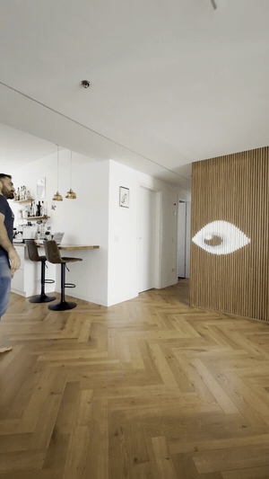

# LED Wall 👁️



A **30 × 120** LED wall (3,600 LEDs) running [WLED](https://kno.wled.ge/), driven by a
Raspberry Pi and some Python. A camera watches the room and the Pi turns what it
sees into light on the wall, live.

**Seen it on Instagram?** The two things in the videos:

- **👁️ The eye** (`eye.py`) — a giant eye built into the wall that finds the nearest
  person with the camera and *follows them around the room*. It blinks, looks around
  when it's bored, and its pupil widens as you get closer.
- **🪞 The mirror** (`mirror_rgb.py`) — stand in front of it and you appear on the
  wall, live, in your real colours, cut out from everything behind you.

The wall also runs 18 generative [effects](#1-wled-effects--web-control-page) with a
phone control page, and [arcade games](#3-games-played-with-a-gamepad) you play on it
with a gamepad.

Everything renders to the same target: a `(120, 30, 3)` uint8 NumPy frame, sent
to WLED over **DDP** (UDP port 4048). WLED is configured as a 2D matrix, so the
code only ever thinks in logical rows and columns — the physical serpentine
wiring is somebody else's problem.

```
  camera / effect / game  ->  (H, W, 3) frame  ->  DDP over UDP  ->  WLED  ->  wall
```

| | |
|---|---|
| Panel | 30 wide x 120 tall, portrait |
| Controller | WLED, 2D matrix mode, DDP enabled |
| Transport | DDP (UDP 4048), chunked at 480 LEDs/packet to stay under the MTU |
| Host | Raspberry Pi 4 (camera work) or any machine on the same LAN |
| Deps | `numpy`, plus `opencv-python` + `mediapipe` for the camera, `evdev` for the gamepad |

Set the panel's IP once at the top of `wall.py` / `niji.py` (`HOST`), or pass
`--host` on the command line.

---

## 1. WLED effects + web control page

Custom animations written for a tall, narrow panel — fire that actually rises
the full 120 rows, rain that has somewhere to fall, a helix that has room to
twist.

### `niji.py` — the effects engine

18 effects, each a generator yielding frames:

`fire` · `rain` (Matrix-style) · `plasma` · `aurora` · `meteors` · `wipe` ·
`fireworks` · `helix` · `lightning` · `warp` · `metaballs` · `vortex` ·
`ripple` · `life` (Conway) · `text` (scrolling message) · `clock` ·
plus `calibrate` and `diag` for checking orientation and wiring.

```bash
python3 niji.py list                            # show every effect
python3 niji.py fire
python3 niji.py rain --fps 30 --bri 0.6
python3 niji.py text --text "HAPPY BIRTHDAY" --scale 2
python3 niji.py all --each 20                   # cycle through everything
python3 niji.py clock --duration 3600           # run for an hour, then stop
```

Common flags: `--host` (panel IP), `--fps`, `--bri` (0..1), `--duration`
(0 = forever), `--hflip` / `--no-vflip` if your panel is mounted differently.
Stop with Ctrl-C; WLED falls back to its own effect a couple of seconds later.

### `niji_web.py` — control it from your phone

A tiny standard-library HTTP server (no Flask, no npm) that imports `niji.py`
and runs the DDP stream in a background thread. Tap an effect on the page and
it switches instantly — no process restart.

```bash
python3 niji_web.py        # serves on http://<this-machine>:8080
```

Open that URL on a phone on the same Wi-Fi. The page is a grid of big
emoji-labelled buttons (🔥 Fire, 🎆 Fireworks, 🌌 Aurora, 🕐 Clock, 🔤 Text …)
with brightness and speed sliders and a field for the scrolling text;
`GET /api/state` and `POST /api/set` are there if you'd rather drive it from a
script or a home-automation box.

---

## 2. The camera: an eye and a mirror

Point a webcam at the wall's viewing spot. The same MediaPipe person-segmentation
pipeline drives two very different looks — an **eye that watches you**, and a
**mirror that becomes you**.

### `eye.py` — the eye that follows you  👁️

One giant almond eye painted across the full width of the panel, centred
vertically. MediaPipe finds the nearest person each frame and the iris + pupil
glide to look straight at them; the lids, iris and catchlight are all drawn with
anti-aliased soft edges, so a 30-pixel-wide eye still reads as an eye. Three
behaviours give it life:

- **Blink** every few seconds (`eye_blink_every`).
- **Idle wander** — after a while with nobody in frame, it slowly looks around on
  its own, so an empty room isn't a dead stare.
- **Dilate** — the pupil widens as you fill more of the camera frame, i.e. as you
  walk up to it.

```bash
python3 eye.py
```

Needs `opencv-python` + `mediapipe` and a camera on `/dev/video0`, same as the
mirror. It shares `calibration.json` (reusing the `rotate` / `flip_code` /
`color_order` / `brightness` keys) and the per-lane `wall_calib.json` wiring fix
with the games, re-reading both **every frame** so you can tune it live. Its own
`eye_*` knobs:

| key | what it does |
|---|---|
| `eye_half_w`, `eye_half_h` | eye size in px (half-width / half-height from centre) |
| `eye_cx`, `eye_cy` | nudge the eye's position on the panel |
| `eye_corner`, `eye_upper`, `eye_lower` | almond shape: pointier canthi, a taller upper lid |
| `eye_iris_r`, `eye_pupil_min`, `eye_pupil_max` | iris size and the pupil's dilation range |
| `eye_iris_col`, `eye_sclera_col`, `eye_catchlight` | colours and the specular glint |
| `eye_track`, `eye_gaze_smooth`, `eye_flip_x` / `eye_flip_y` | how far / how smoothly the gaze follows, and its direction |
| `eye_blink`, `eye_idle`, `eye_dilate` | toggle each behaviour (`1` / `0`) |
| `eye_lane_correct` | apply the per-lane wiring fix inside the render (`1` / `0`) |

### `mirror_rgb.py` — the mirror you step into

Stand at the wall and you appear on it, live. The segmentation model cuts you out
of the video; everything outside the mask goes black, so the wall shows a moving
human shape and nothing else. Walk past it and it walks past with you.

Your **real video colours** inside a MediaPipe SelfieSegmentation mask: a red
shirt is red on the wall, skin reads as skin, a hand raised over your chest is
visible as a separate shape.

```bash
python3 mirror_rgb.py
```

Requires `opencv-python` and `mediapipe`, and a camera on `/dev/video0`. It
grabs MJPG frames with `CAP_PROP_BUFFERSIZE=1` — on a Pi the driver otherwise
queues frames and you end up mirroring where you were a second ago.

### Tuning: `calibration.json`

The mirror re-reads `calibration.json` from its own directory **every frame**,
so you can sit at the wall, edit the file, and watch the change land — no
restart. It's created with defaults on first run.

| key | what it does |
|---|---|
| `rotate`, `flip_code` | orient the camera to match the wall |
| `zoom`, `pan_x`, `pan_y` | frame the person in the tall 30x120 aspect |
| `offset_x`, `offset_y` | nudge the output on the panel |
| `brightness`, `color_order` | global level, RGB/GRB channel order |
| `mask_threshold`, `smoothing`, `denoise`, `erode` | how tight and how stable the cutout is |
| `rgb_mask` | `1` = person on black (the mirror look), `0` = raw full video |
| `rgb_sat`, `rgb_gamma`, `rgb_gain` | make clothes pop on LEDs; gamma < 1 lifts dark indoor mids |
| `rgb_auto`, `rgb_auto_target` | auto-exposure so it survives changing room light |
| `rgb_idle`, `rgb_idle_bright`, `rgb_idle_delay` | after N seconds with nobody there, fade to a dim idle glow |

### Running it as a service

`mirror.service` is a systemd unit for a Pi: starts after the network is up,
restarts on failure, and stops with SIGTERM (the script traps it to release the
camera cleanly, otherwise the next start finds `/dev/video0` busy).

```bash
sudo cp mirror.service /etc/systemd/system/
sudo systemctl enable --now mirror
```

Adjust `User=`, `WorkingDirectory=` and the venv path inside it first.

### The other `mirror_*.py` files

Earlier takes, kept because they're each interesting on their own:

- `mirror_led.py`, `mirror_bgsub.py` — MOG2 background subtraction, one flat
  silhouette colour. No ML dependency and very fast, but MOG2 absorbs anything
  that holds still (stand there long enough and your legs disappear) and gives
  up on dark clothes against a dark background. That's what pushed the project
  to MediaPipe.
- `mirror_udp.py`, `mirror_udp_fast.py`, `mirror_udp_orig.py` — the MediaPipe
  mask as a solid colour fill, at various stages of latency surgery.
- `mirror_parts.py`, `mirror_multiclass.py` — multi-class segmentation, colouring
  hair / skin / clothes differently.
- `mirror_claude.py`, `test.py`, `t.py` — scratch copies from the way there.

---

## 3. Games, played with a gamepad

The wall is 30 x 120. At 3 pixels per block that's a **10 x 40 grid** — which is
exactly a standard falling-blocks well, and a genuinely good shape for anything that
falls. So it became an arcade cabinet.

Input is a gamepad read through `evdev` (developed with a Flydigi Vader 4 Pro in
XInput mode, which enumerates as a plain "Microsoft X-Box 360 pad", so any
XInput controller should work). The device is auto-detected; override it with
`--dev /dev/input/eventN`. Install with `pip3 install evdev`.

### `block_game.py`

A 10-wide, 36-deep well with a HUD at the top showing the next piece.

```bash
python3 block_game.py
python3 block_game.py --dev /dev/input/event4 --fps 30
```

| control | action |
|---|---|
| left / right | move |
| down | soft drop |
| A / B | rotate CW / CCW |
| X / Y | hard drop |
| Start, L / R | pause; restart after game over |

### `snake.py`

10 x 40 of snake — a long, tall playfield. `--wrap` lets you pass through the
walls instead of dying at them. Steer with the stick or D-pad (no reversing into
yourself), A or Start to pause and to restart.

### `space_invaders.py`

Two rows of score HUD over a 10 x 38 field. The wall's height works in the
game's favour: the invaders get a long march down at you instead of the usual
few rows. Stick or D-pad to move, any face button to fire (one shot on screen at
a time, classic-style).

### `camera_breakout.py`

Breakout where **you are the paddle**. It reuses the mirror's camera and
MediaPipe pipeline, takes the horizontal centroid of the person mask, and moves
the paddle with it. Bricks at the top, ball falling down the tall panel, you
stepping left and right in front of the camera. No buttons — it serves and
restarts itself.

```bash
python3 camera_breakout.py
python3 camera_breakout.py --no-flip      # if left/right feels reversed
python3 camera_breakout.py --margin 0.2   # how far you have to actually move
```

### Straightening the wall: `wall.py`, `calib.py`, `ledtest.py`

The panel is built from two serpentine snakes of 1800 LEDs, and the left half
has a wiring quirk: alternating vertical lanes sit a couple of LEDs off along
their length, so a straight horizontal row renders as a **comb**.

`wall.py` fixes it in exactly one place. It owns the DDP socket, the geometry
and a per-lane offset table, and every tool sends through it:

```python
from wall import DDP, W, H
ddp = DDP()
ddp.send(frame)          # (H, W, 3) uint8, correction applied for you
```

The offsets live in `wall_calib.json`. To tune them for your own build:

```bash
python3 ledtest.py --raw    # correction off — you should see the comb
python3 ledtest.py          # correction on  — rows should be straight
python3 calib.py            # interactive, with the gamepad
```

In `calib.py`, left/right selects a lane (drawn in bright yellow), up/down
nudges it by one LED until its dots line up with its neighbours, **A** saves.
**B** resets the selected lane, **Y** resets all of them, **Start** quits.
Everything that goes through `wall.py` picks the new offsets up.

---

## Layout

```
niji.py               18 effects + CLI          } 1. effects
niji_web.py           phone control panel       }

eye.py                the eye that follows you  } 2. camera
mirror_rgb.py         the silhouette mirror     }
mirror_*.py           earlier approaches        }
mirror.service        systemd unit              }

wall.py               shared DDP + lane fix     } 3. games
calib.py, ledtest.py  lane calibration          }
block_game.py         falling-blocks stacker    }
snake.py              snake                     }
space_invaders.py     space invaders            }
camera_breakout.py    camera as the paddle      }
```

`niji.py` predates `wall.py` and still carries its own DDP sender; the games and
newer tools all go through `wall.py`.

---

## License

MIT — see [LICENSE](LICENSE). Build one, change the dimensions, take the effects.

